<!-- Gerado por gerar.mjs a partir de perfil.config.mjs. Edite o config, não este arquivo. -->

<a href="https://github.com/luancatheringer/luancatheringer/blob/main/curriculo.md"><b>Currículo completo</b></a> · <a href="https://instagram.com/lcautomacoes.ai">@lcautomacoes.ai</a>

