<!-- Gerado por gerar.mjs a partir de curriculo.config.mjs. Edite o config, não este arquivo. -->

**Gestor de automação · integrações por API, IA e sistemas sob medida**  
Belo Horizonte, MG · [@lcautomacoes.ai](https://instagram.com/lcautomacoes.ai) · [github.com/luancatheringer](https://github.com/luancatheringer)

## Resumo

Sou gestor de automação. Não venho da programação: construo com IA, no que hoje se chama vibe coding. Descrevo o que precisa ser feito, o Claude escreve o código comigo e eu testo, ajusto e coloco no ar. É assim que conecto ERP, CRM, WhatsApp, marketplaces, loja virtual e o ERP da fábrica por API e webhook, crio rotinas de controle e mantenho uma plataforma de gestão usada por quatro setores. Todo fluxo passa por homologação antes de ligar, primeiro com um item e depois com o lote, e segue acompanhado depois que entra em produção.

## Experiência

### Sistemas

- **Plataforma de gestão.** Sistema web feito do zero com IA e usado todo dia por quatro setores. Nos marketplaces (três canais): vendas ao vivo, atendimento ao cliente numa caixa só, proteção de marca, promoções, publicidade, criadores, amostras e lives. No financeiro: do bruto ao líquido, tarifas, margem real e conciliação com baixa no ERP em um clique, com travas de conferência. No comercial e no marketing: vendas por vendedor e região, o atendimento da equipe no WhatsApp, a loja, o blog e uma central que lê as automações a cada 5 minutos e explica cada falha em português. Tudo em tempo real, com tela inicial de todos os canais, chat e chamadas de vídeo da equipe, acesso por setor e login em duas etapas. São 1.358 atualizações em 11 semanas e mais de 110 funções no ar. Claude (vibe coding) · Next.js · Supabase · Cloudflare · WebRTC · Claude API

### Integrações por API

- **Pedido B2B no ERP certo.** Integração entre o CRM de vendas e o ERP que fatura cada pedido pela empresa escolhida pelo vendedor, com as parcelas de 24 condições de pagamento, a tradução dos códigos de produto entre as contas, as observações do pedido e uma trava contra duplicidade. Em produção desde outubro, convivendo com a integração nativa: um serviço na nuvem cancela em menos de um segundo a cópia que ela cria na outra conta. Sem erro nas primeiras semanas.
- **Lead direto no WhatsApp.** Cada cadastro da landing page vira contato, card no funil e primeira mensagem no WhatsApp, já com o vendedor da região, e o fluxo liga e desliga sozinho no horário comercial. Em uso desde julho, com erro em menos de 0,2% das execuções. Em outubro, migrou para a nova ferramenta de e-mail marketing sem parar a captação: webhook em XML, telefone padronizado, origem reconstruída pelas UTMs e o contato que já existia atualizado em vez de duplicado.
- **Homologação de API para parceiro externo.** Rotas de leitura do CRM de vendas homologadas para uma consultoria parceira construir a integração, com sincronização inicial paginada e depois incremental por cursor: 10 rotas validadas no ambiente de teste e 7 liberadas em produção. Junto foi um resumo em PDF de todos os fluxos de automação da empresa, por área, com função e situação.
- **Operações em lote pela API.** Listas de prospecção e de campanha viraram mais de mil cards no funil do vendedor, carteiras inteiras passaram para uma nova responsável conferidas card a card, atendimentos de campanha foram para a equipe certa e mais de 2 mil promoções antigas foram desativadas na loja virtual. Sempre com teste em poucos itens, backup antes e conferência no fim: zero duplicado e zero falha.
- **Leads recuperados pelo webhook.** Leads que saíram da fila de processamento voltaram ao fluxo reenviados pelo webhook, a partir da exportação da ferramenta de marketing, sem perda.
- **Relatórios direto da API.** Dados puxados das APIs do CRM de vendas e da plataforma de WhatsApp quando a tela do sistema não entrega o recorte que a gestão precisa.

### WhatsApp e atendimento

- **Consulta de pedido no WhatsApp.** O cliente informa o número do pedido ou o CPF e recebe status, itens, previsão e rastreio consultados no ERP, com menu de ajuda e transferência para a equipe. Uma rotina mantém a autorização da API sempre ativa. Em produção desde outubro.
- **Lembrete de boleto em PDF.** Um dia antes do vencimento, o cliente recebe no WhatsApp o boleto em PDF, enviado pela equipe da região dele, nas duas contas do ERP. O PDF é gerado na hora por um serviço na nuvem, em cerca de 7 segundos, com trava contra envio repetido e modelo de mensagem aprovado pela Meta. Em produção desde novembro.
- **Aviso de pedido ao vendedor.** Pedido novo de cidades da carteira de um vendedor chega no WhatsApp dele com o cliente, a empresa que faturou e um botão que abre o pedido no ERP, sem aviso repetido e com reenvio automático se falhar. Uma conferência diária cruza os pedidos com os avisos e só chama atenção se faltar algum.
- **Triagem do WhatsApp comercial.** Chatbot com ordem fixa de verificação: horário, rotas especiais, contato que volta, região e menu só para quem é novo.
- **Prospecção que vira card.** O vendedor aplica uma etiqueta e a oportunidade entra no funil sem duplicar; o mesmo vale para o contato que chega pelo Instagram, e a etiqueta de cliente marca o negócio como ganho. Zero erro nas execuções.
- **Listas de prospecção no funil.** A planilha do vendedor vira cards na etapa certa, sem duplicar, e separa quem não tem WhatsApp.
- **Entrada de campanha.** A frase do anúncio leva o contato a um fluxo próprio, que etiqueta, cria o card do gerente e transfere, sem card repetido.
- **Campanha de primeira compra.** Disparos no WhatsApp separados por região e origem do contato, com follow-up em etapas e relatório consolidado de entrega, leitura e interação.
- **Aviso de pedido enviado.** Oito modelos de mensagem aprovados pela Meta, um para cada transportadora, com botão de rastreio. Pronto e testado.
- **Nota fiscal em PDF pelo WhatsApp.** O serviço que gera o PDF da nota já está no ar; o envio ao cliente na hora em que o pedido fatura está em teste.

### Controles e prevenção de fraude

- **Alerta de compra suspeita.** O ERP avisa cada pedido novo do site e um serviço na nuvem confere seis sinais de risco, como cadastro já ligado a contestação, endereço já usado em fraude por outra pessoa e tentativas recusadas no pagamento. Só quando encontra algo ele aciona o fluxo, e o financeiro recebe no WhatsApp a classificação do risco, o motivo e um botão que abre o pedido. Quatro pedidos suspeitos foram cancelados antes do envio, e o teste com 30 dias de pedidos não deu nenhum falso positivo.
- **Rastreio contra chargeback.** Script que cruza a exportação da plataforma de pagamento com o ERP e devolve o código de rastreio dentro do prazo de defesa. Roda três vezes por semana, encontra sozinho mais de 90% dos pedidos e também pode ser disparado pela plataforma de gestão.
- **Relatório de chargebacks.** Rodada semanal com uma base mestre que detecta reincidência e padrões de má-fé; a mesma base alimenta o alerta de compra suspeita. Catorze rodadas desde agosto.

### Estoque e operação

- **Estoque dos marketplaces conferido com o ERP.** O estoque dos centros de distribuição de dois marketplaces foi conferido com os depósitos do ERP e os acertos foram lançados pela API, conferidos um a um e com opção de desfazer. Desde então, uma conferência semanal manda a diferença por produto e o acerto sugerido.
- **Planilhas ligadas ao ERP.** Na planilha de contagem do centro de distribuição, um botão busca o saldo do produto nas duas contas do ERP por um serviço na nuvem que guarda as chaves, e o conferente digita só a contagem física. Na planilha de preços de uma campanha, o saldo somado das duas contas entrou pela API, com os itens zerados em destaque.
- **Varredura de estoque.** Fluxo que varre o catálogo do ERP, separa os itens sem saldo ou abaixo do mínimo e prepara uma análise com IA para revisão. Pronto e testado.

### Fábrica: cadastro técnico e dados

- **Migração do cadastro técnico para o novo ERP.** Fórmulas, fichas e versões de produto extraídas de um sistema antigo que não exporta tudo e carregadas no ERP novo por planilha, com piloto de um item antes de cada lote: 204 produtos extraídos sem erro, 1.176 de 1.182 percentuais de fórmula idênticos na conferência (as diferenças foram corrigidas), 133 versões com embalagens, 740 especificações de qualidade, custos, imagens e textos de rótulo lidos de fotos.
- **Estoque e documentos da fábrica.** Estoque inicial de insumos com lote e validade (380 registros, zero erro), mínimo e máximo de 150 matérias-primas e a lista mestra de documentos no sistema: 28 documentos com prazo de alerta e 60 certificados de calibração com o PDF anexado.
- **Auditoria de classificação fiscal.** Classificação fiscal de 133 produtos cruzada entre quatro sistemas, com as divergências e ausências apontadas numa planilha, sem alterar nada.
- **Tabela de preços e códigos de barras.** Tabela de preços regravada a partir do preço de cada versão (134 registros, zero erro) e 12 códigos de barras gerados, ativados e entregues em etiquetas, com um guia ilustrado do processo.

### Relatórios e análises

- **Relatório comercial semanal.** Vendas do CRM e funil do WhatsApp num deck de layout fixo, gerado toda semana por uma rotina com IA.
- **Custo de vender em cada marketplace.** Tudo o que sai do bruto em três marketplaces (comissão, frete, publicidade, armazenagem e cobranças indiretas), por pedido, produto e mês, conferido com o extrato oficial; virou tela na plataforma de gestão.
- **Leitura do atendimento comercial.** Taxa de resposta por modelo de mensagem e pontos fortes e de atenção de cada vendedor.
- **Modelo de metas por vendedor.** Base do último trimestre e fator sazonal nos meses de baixa, gerado por script.
- **Política de descontos para campanha sazonal.** Histórico da campanha anterior cruzado com a tabela de preços: faixas de desconto por grupo de produto e o efeito simulado no desconto médio e na margem, em três versões.
- **Tempo de atendimento nos marketplaces.** Diagnóstico do tempo de primeira resposta e das causas de venda com problema, com plano de meta.
- **Auditoria de preço de revendedores.** Anúncios comparados ao preço da loja oficial; o levantamento também encontrou uma marca falsa copiando o produto.
- **Auditoria do e-commerce.** Revisão completa de páginas, links, SEO e acessibilidade: 43 achados em duas levas, entregues em listas priorizadas.

### Blog, conteúdo e documentos

- **Migração do blog sem perder busca orgânica.** Blog antigo levado para o WordPress: 142 textos convertidos por script e publicados com capa nova criada com IA, 144 redirecionamentos 301 com 100% de acerto, 480 links ajustados e nenhum quebrado, e os 199 textos do blog com nota verde de SEO e de legibilidade. Concluída em outubro.
- **Saúde semanal do blog.** Toda segunda, uma rotina com IA cruza os dados de busca com as notas de SEO de cada texto, explica o que caiu e propõe o ajuste, que só entra com aprovação. Textos novos e reformulados seguem o mesmo cuidado, com exemplo visual aprovado antes de publicar.
- **Documentos preenchíveis em PDF.** Playbook de onboarding de 24 páginas (109 caixas de marcação e 43 campos) e roteiro de reunião individual (44 campos), com os campos inseridos por script sem mexer na diagramação.
- **Propostas para a diretoria.** Propostas em PDF com regra, simulação e cronograma em gráfico, em versões para a diretoria e para a equipe, com todas as contas conferidas.

## Outros trabalhos

- Sistema de agentes de IA por área: documento de arquitetura e base técnica com 31 agentes registrados e 118 testes automatizados; as peças estão indo para dentro da plataforma de gestão.
- Orçamento criado direto no ERP pela plataforma de gestão: estudo e mapeamento campo a campo.
- Fechamento mensal de comissão de influenciadores com IA, a partir da planilha exportada; virando ferramenta dentro da plataforma.
- CRM de prospecção regional: escopo e arquitetura de um CRM com mapa de lojistas, funil e assistente de IA.
- Agente de IA para mensagens do Instagram: triagem entre produto, pedido, parceria e influenciador (protótipo testado).

## Projetos próprios

- LC Automações (@lcautomacoes.ai): 12 vídeos curtos animados feitos em código com IA, com narração, legenda que acende palavra a palavra e trilha própria, mais 13 posts e carrosséis de cases para o Instagram e o LinkedIn.
- Este perfil: as artes animadas, o README e este currículo saem de um script feito com o Claude; os números vêm direto do histórico da plataforma e do próprio currículo.
- Backup diário do ambiente de trabalho com IA (memória, conversas e arquivos) na nuvem, com restauração testada em outro computador.

## Competências

- **Integrações por API:** REST, webhooks, XML e JSON, OAuth com renovação automática; ERP, CRM, WhatsApp, marketplaces, loja virtual, plataforma de pagamento, blog e ERP de fábrica
- **Homologação:** teste de ponta a ponta antes de ligar, piloto com um item antes do lote, homologação de rotas com fornecedor de API e acompanhamento depois da virada
- **Operações em lote:** importação, atualização e desativação em massa pela API, com backup antes, conferência no fim e opção de desfazer
- **Automação sem código:** fluxos de automação, chatbots e WhatsApp Business com modelos aprovados pela Meta
- **IA no dia a dia:** vibe coding com o Claude, agentes de IA por área (design, segurança, testes), rotinas agendadas com IA, imagens geradas com IA e análise de conversas
- **Rotinas e monitoramento:** conferências diárias e semanais agendadas que só avisam quando algo foge do esperado
- **Dados e relatórios:** planilhas, relatórios e apresentações automáticas, com scripts feitos com IA
- **Segurança e LGPD:** verificação em duas etapas, acesso por setor, revisão de segurança antes de publicar, cuidado com dado pessoal e com os termos de uso das APIs

---

Automatizar é fácil. Não quebrar é o difícil. · [voltar ao perfil](https://github.com/luancatheringer)
